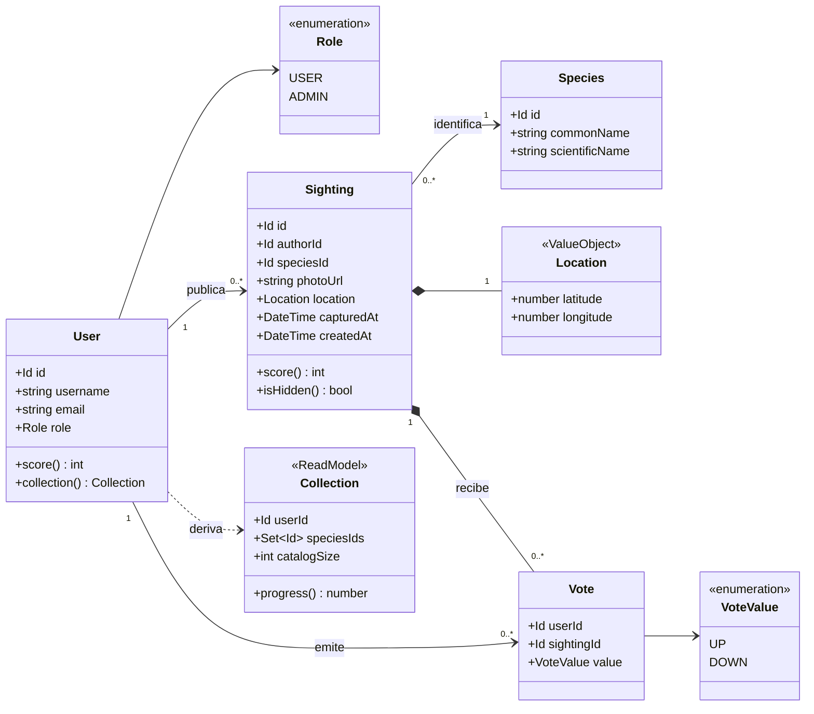
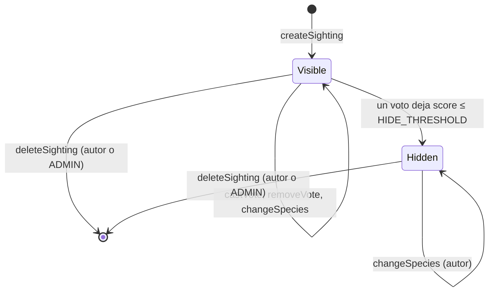

# AvistApp — Modelo de dominio

Fuente: [`1_BRIEF.md`](1_BRIEF.md). Este documento está en español; los términos del dominio (entidades, atributos, enums, casos de uso, errores y constantes) están en inglés y se usan tal cual en el código. Los textos de la interfaz van en español.

## 1. Lenguaje ubicuo

| Término (dominio) | Término en la UI | Definición |
|---|---|---|
| `User` | Usuario | Persona registrada que usa la app. Tiene un `Role` |
| `Role` | Rol | `USER` o `ADMIN`. `ADMIN` además puede eliminar avistamientos de otros usuarios |
| `Species` | Especie | Elemento del catálogo de aves de Chile; solo lectura |
| Catalog | Catálogo | Conjunto completo de `Species`. Su tamaño es la meta de la colección |
| `Sighting` | Avistamiento / Publicación | Foto de un ave, con su especie, ubicación y momento de captura, publicada por un usuario |
| `Location` | Ubicación | Coordenadas GPS capturadas junto con la foto |
| `Vote` | Voto | +1 (`UP`) o −1 (`DOWN`) que un usuario da al avistamiento de otro |
| Sighting score | Puntaje de la publicación | Suma de los valores de los votos de un avistamiento |
| Hidden sighting | Publicación oculta | Avistamiento cuyo puntaje llegó a `HIDE_THRESHOLD`; sale del muro |
| `Collection` | Colección | Especies distintas que un usuario tiene en avistamientos visibles |
| User score | Puntaje del usuario | Suma de los puntajes de sus avistamientos más el bonus por especie |
| Feed | Muro | Lista de avistamientos visibles de todos los usuarios |
| My sightings | Mis publicaciones (mantenedor) | Lista de los avistamientos propios, incluidos los ocultos |

## 2. Constantes

| Nombre | Valor | Regla |
|---|---|---|
| `HIDE_THRESHOLD` | `-5` | SG6 |
| `SPECIES_BONUS` | `10` | C3 |

Ambos son valores iniciales. Cambiar `HIDE_THRESHOLD` reevalúa todos los avistamientos existentes.

## 3. Entidades y relaciones

- `Id` es un identificador único opaco. `DateTime` es un instante absoluto en UTC.
- Los métodos (`score()`, `isHidden()`, `collection()`, `progress()`) son **derivados** del estado actual y no se guardan como hechos del dominio. La persistencia puede cachearlos, pero la verdad la definen las reglas de abajo.
- `Vote` no tiene id propio: su identidad es el par `(userId, sightingId)`.
- `Sighting *-- Vote`: los votos pertenecen al avistamiento y se eliminan con él.
- Contraseñas y sesiones son responsabilidad del proveedor de autenticación (ver `3_STACK.md`), no del dominio.

## 4. Ciclo de vida de un avistamiento

`Hidden` es definitivo: los votos quedan congelados (V5), así que un avistamiento oculto nunca vuelve a ser visible. La única salida es eliminarlo.

## 5. Reglas de negocio

### User
- **U1** `email` es obligatorio, válido y único (sin distinguir mayúsculas).
- **U2** `username` es obligatorio, único (sin distinguir mayúsculas), de 3 a 20 caracteres, solo `a-z`, `A-Z`, `0-9` y `_`.
- **U3** La contraseña tiene al menos 8 caracteres. Se valida al registrarse y nunca se guarda en el dominio.
- **U4** Los usuarios nuevos reciben el rol `USER`. `ADMIN` se asigna fuera de la app.

### Species
- **S1** El catálogo es de solo lectura para todos los roles dentro de la app.
- **S2** `scientificName` es único. `commonName` es el nombre común en español que se muestra en la UI.

### Sighting
- **SG1** `photoUrl`, `location`, `capturedAt` y `speciesId` son obligatorios. La foto viene de la cámara de la app; `location` y `capturedAt` se toman del dispositivo en el momento de la captura. Al crear, el caso de uso recibe **los datos de la imagen capturada** (no una ruta a un archivo temporal) y la persistencia asigna `photoUrl` al guardarla.
- **SG1a** Un avistamiento existe solo si su foto quedó guardada. Si guardar la foto falla, `createSighting` no deja ningún avistamiento creado, y la foto capturada sigue disponible para reintentar.
- **SG2** `location.latitude` ∈ [−90, 90] y `location.longitude` ∈ [−180, 180]. No se valida que las coordenadas estén dentro de Chile.
- **SG3** Solo el autor puede cambiar `speciesId`. `photoUrl`, `location`, `capturedAt`, `authorId` y `createdAt` son inmutables.
- **SG4** Solo el autor o un `ADMIN` puede eliminar un avistamiento. La eliminación es definitiva y borra sus votos.
- **SG5** `score = suma(vote.value)`, con `UP = +1` y `DOWN = −1`. Un avistamiento sin votos tiene puntaje `0`.
- **SG6** `isHidden ⇔ score ≤ HIDE_THRESHOLD`.
- **SG7** `createdAt` lo asigna quien persiste al publicar (el servidor en la etapa 2; en la etapa 1, la capa de datos local con el reloj del dispositivo); `capturedAt` viene del dispositivo en el instante del disparo.

### Vote
- **V1** Como máximo un voto por `(userId, sightingId)`.
- **V2** `value` es `UP` o `DOWN`.
- **V3** Un usuario no puede votar su propio avistamiento.
- **V4** Quien votó puede cambiar el valor o retirar su voto mientras el avistamiento esté visible.
- **V5** En un avistamiento oculto no se pueden emitir, cambiar ni retirar votos.
- **V6** Cualquier rol puede votar, incluido `ADMIN`.

### Collection y puntaje del usuario
- **C1** `collection(user)` = `speciesId` distintos de los avistamientos del usuario que **no están ocultos**.
- **C2** `progress = |collection| / |catálogo|`.
- **C3** `userScore = suma(score de todos los avistamientos del usuario, incluidos los ocultos) + SPECIES_BONUS × |collection|`.
- **C4** Todo se calcula desde el estado actual; no hay historial de puntos. Eliminar un avistamiento quita sus votos del puntaje del usuario y puede quitar su especie de la colección, junto con el bonus. Publicar y eliminar repetidamente no suma puntos.

### Consultas
- **Q1** Muro: todos los avistamientos visibles de todos los usuarios (incluidos los del usuario actual), ordenados por `createdAt` descendente.
- **Q2** Para un `ADMIN`, el muro también incluye los avistamientos ocultos, marcados como ocultos.
- **Q3** Cada elemento del muro muestra el puntaje del avistamiento y el voto del usuario actual, si existe.
- **Q4** Mis publicaciones: todos los avistamientos del usuario actual, incluidos los ocultos (marcados), ordenados por `createdAt` descendente.

## 6. Casos de uso

| Caso de uso | Actor | Efecto | Reglas | Errores |
|---|---|---|---|---|
| `register` | Visitante | Crea un `User` con rol `USER` e inicia sesión | U1–U4 | `INVALID_EMAIL`, `EMAIL_TAKEN`, `INVALID_USERNAME`, `USERNAME_TAKEN`, `WEAK_PASSWORD` |
| `login` | Visitante | Inicia sesión | — | `INVALID_CREDENTIALS` |
| `logout` | Usuario | Cierra la sesión | — | — |
| `listSpecies` | Usuario | Devuelve el catálogo ordenado por `commonName`, marcando las especies que ya están en la colección del usuario | S1, C1 | — |
| `createSighting` | Usuario | A partir de la foto capturada, la ubicación y la especie, crea un `Sighting` visible con puntaje 0 e indica si su especie es nueva en la colección del usuario. Es atómico respecto de la foto (SG1a) | SG1, SG1a, SG2, SG7, C1 | `PHOTO_REQUIRED`, `INVALID_LOCATION`, `SPECIES_NOT_FOUND` |
| `changeSpecies` | Autor | Reemplaza `speciesId`; los votos se mantienen | SG3, C1 | `SIGHTING_NOT_FOUND`, `NOT_OWNER`, `SPECIES_NOT_FOUND` |
| `deleteSighting` | Autor o `ADMIN` | Elimina el avistamiento y sus votos | SG4, C4 | `SIGHTING_NOT_FOUND`, `FORBIDDEN` |
| `castVote` | Usuario distinto del autor | Crea el voto o cambia su valor; puede ocultar el avistamiento | V1–V6, SG6 | `SIGHTING_NOT_FOUND`, `OWN_SIGHTING`, `SIGHTING_HIDDEN` |
| `removeVote` | Quien votó | Elimina el voto del usuario | V4, V5 | `SIGHTING_NOT_FOUND`, `VOTE_NOT_FOUND`, `SIGHTING_HIDDEN` |
| `getFeed` | Usuario | Devuelve los elementos del muro | Q1–Q3 | — |
| `getMySightings` | Usuario | Devuelve los avistamientos propios | Q4 | — |
| `getProfile` | Usuario | Devuelve `username`, `role`, `userScore` desglosado (suma de votos y bonus) y `collection` con su progreso y la foto visible más reciente de cada especie | C1–C3 | — |

Todos los casos de uso, salvo `register` y `login`, requieren sesión activa (si no, `UNAUTHENTICATED`).

Las fallas de infraestructura (la cámara no abre o no toma la foto, el GPS no responde, no se puede escribir en el almacenamiento) no son errores de dominio: no tienen código propio. La interfaz las muestra con los textos de `4_DESIGN.md` §8 y conserva el estado para que el usuario pueda reintentar. La falta de ubicación al disparar se informa con el texto de `INVALID_LOCATION`.
