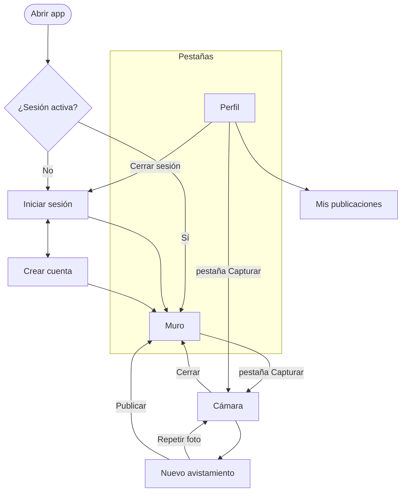

# AvistApp — Diseño

Fuentes: [`1_BRIEF.md`](1_BRIEF.md), [`2_DOMAIN.md`](2_DOMAIN.md), [`3_STACK.md`](3_STACK.md). Los nombres de código (rutas, componentes, tokens) están en inglés; los textos de la interfaz, en español.

## 1. Dirección visual: guía de campo

La app se inspira en una guía de campo de aves: papel cálido, nombres de especies en tipografía serif y el nombre científico en cursiva, como en las guías impresas. La interfaz es limpia y casi plana, para que **la foto sea siempre el elemento con más color**.

- **Naranja** (como el pecho del chucao): acción principal y acentos.
- **Verde claro** (como el bosque y los brotes): fondos suaves, progreso y estados positivos.
- **Neutros cálidos**: fondo tipo papel y texto verde muy oscuro en vez de negro puro.

Principios:
1. **Foto primero.** Las fotos van de borde a borde en las tarjetas, sin filtros ni marcos decorativos.
2. **Una acción principal por pantalla.** Solo un botón naranja relleno a la vez.
3. **Plano y con aire.** Bordes finos en vez de sombras, espacios generosos y poco texto.
4. **Coleccionar se siente.** El progreso de la colección y el bonus por especie nueva siempre se ven.

Solo hay tema claro (`"userInterfaceStyle": "light"` en `app.json`).

## 2. Color

| Token | Hex | Uso |
|---|---|---|
| `paper` | `#FBF8F1` | Fondo de todas las pantallas |
| `white` | `#FFFFFF` | Tarjetas, campos, barra de pestañas |
| `ink` | `#1F2A1E` | Texto principal |
| `ink-muted` | `#5D6957` | Texto secundario: fechas, coordenadas, nombre científico |
| `line` | `#E4E6DA` | Bordes de tarjetas y separadores (decorativo) |
| `line-strong` | `#8A9381` | Borde de campos de formulario |
| `primary-50` | `#FFF3E6` | Fondo del aviso de especie nueva |
| `primary-100` | `#FFE2C4` | Fondo de chips seleccionados |
| `primary-500` | `#E97F2E` | Solo decorativo: anillo del disparador. Nunca para texto |
| `primary-600` | `#BC5618` | Botón principal, pestaña activa, relleno de la barra de progreso |
| `primary-700` | `#9E4614` | Enlaces, botón principal presionado |
| `secondary-50` | `#F3F8EC` | Fondo de login y registro |
| `secondary-100` | `#E2EFD2` | Botón secundario, insignias, fondo de la barra de progreso |
| `secondary-200` | `#C8E0AC` | Decorativo: avatar con inicial |
| `secondary-600` | `#4A7531` | Voto positivo activo, ícono "en tu colección" |
| `secondary-700` | `#3A5D25` | Texto sobre fondos verdes |
| `danger-50` | `#FDECEA` | Fondo de mensajes de error |
| `danger-600` | `#B42318` | Errores, botón eliminar, voto negativo activo |

### Contraste (WCAG 2.1)

Todas las combinaciones de texto cumplen AA (≥ 4.5:1) y los elementos gráficos, ≥ 3:1. Los valores están calculados.

| Primer plano / fondo | Contraste | Uso |
|---|---|---|
| `ink` / `paper` | 14.06 | Texto principal |
| `ink-muted` / `paper` | 5.46 | Texto secundario |
| `ink-muted` / `white` | 5.80 | Texto secundario en tarjetas |
| `white` / `primary-600` | 4.68 | Texto del botón principal |
| `primary-600` / `white` | 4.68 | Pestaña activa |
| `primary-700` / `paper` | 5.93 | Enlaces |
| `primary-700` / `primary-50` | 5.75 | Aviso de especie nueva |
| `secondary-700` / `secondary-100` | 6.32 | Botón secundario, insignias |
| `secondary-600` / `white` | 5.41 | Voto positivo activo |
| `danger-600` / `white` | 6.57 | Errores, eliminar, voto negativo activo |
| `ink-muted` / `line` | 4.59 | Insignia "Oculta" |
| `secondary-700` / `secondary-200` | 5.31 | Inicial del avatar |
| `primary-600` / `secondary-100` | 3.91 | Barra de progreso (gráfico) |
| `line-strong` / `white` | 3.20 | Borde de campos (gráfico) |

## 3. Tipografía

| Familia | Uso | Pesos |
|---|---|---|
| **Fraunces** (serif) | Títulos, nombres comunes de especies, puntaje | 600; 400 cursiva para nombres científicos |
| **Figtree** (sans) | Todo el resto: texto, botones, campos, pestañas | 400, 500, 600 |

Se cargan con `@expo-google-fonts/fraunces` y `@expo-google-fonts/figtree`. Los archivos de fuente van dentro de la app, así que no se llama a ningún servicio externo.

| Estilo | Fuente | Tamaño / interlineado | Uso |
|---|---|---|---|
| `title` | Fraunces 600 | 28 / 34 | Título de pantalla, puntaje del perfil |
| `heading` | Fraunces 600 | 20 / 26 | Nombre común de la especie en tarjetas |
| `scientific` | Fraunces 400 cursiva | 14 / 20 | Nombre científico, siempre bajo el nombre común |
| `body` | Figtree 400 | 16 / 24 | Texto general, campos |
| `label` | Figtree 600 | 14 / 20 | Botones, etiquetas de campos, pestañas |
| `caption` | Figtree 400 | 13 / 18 | Autor, fecha, coordenadas |

El texto respeta el tamaño de letra del sistema (`allowFontScaling` activo).

## 4. Forma, espacio e íconos

- Retícula de 4 px. Margen de pantalla 16 px. Separación entre tarjetas 16 px.
- **Área segura:** ningún contenido ni botón queda bajo la barra de estado, el *notch* o la isla dinámica. Las pantallas de pestañas respetan el área segura superior; las pantallas con encabezado propio lo bajan lo suficiente (implementación en `3_STACK.md` §8). Solo la cámara va de borde a borde.
- Tarjetas: fondo `white`, borde 1 px `line`, radio 16 px, sin sombra. La foto ocupa todo el ancho de la tarjeta, con proporción 4:3 (ver la nota de proporciones en §10).
- Botones: alto 48 px, forma de píldora (radio completo), texto `label`.
  - Principal: fondo `primary-600`, texto blanco.
  - Secundario: fondo `secondary-100`, texto `secondary-700`.
  - Peligro: fondo transparente, texto `danger-600`.
  - Deshabilitado: opacidad 40 %.
- Campos: alto 48 px, fondo `white`, borde 1 px `line-strong`, radio 12 px. La etiqueta va arriba y el error abajo, en `danger-600`. Con foco, el borde pasa a 2 px `primary-600`.
- Área táctil mínima de 44 × 44 px, también en botones de solo ícono.
- Íconos: solo **Ionicons** (`@expo/vector-icons`), versión de contorno; la versión rellena indica estado activo.
- Avatar: círculo de 36 px con la inicial del usuario, fondo `secondary-200` y texto `secondary-700`.

## 5. Movimiento

Poco y con propósito. Todo se desactiva si el sistema tiene activada la opción de reducir movimiento (`useReducedMotion` de Reanimated).

| Momento | Animación |
|---|---|
| Votar | El ícono crece a 1.2× y vuelve en 150 ms |
| Abrir el perfil | La barra de colección se llena de 0 al valor actual en 400 ms |
| Publicar una especie nueva | El aviso de especie nueva entra desde arriba y se oculta a los 3 s |
| Una publicación se oculta tras un voto | La tarjeta se desvanece y sale del muro |

Las transiciones entre pantallas son las nativas de Expo Router.

## 6. Navegación



| Ruta (`app/`) | Pantalla | Presentación | Acceso |
|---|---|---|---|
| `(auth)/login.tsx` | Iniciar sesión | Pila | Sin sesión |
| `(auth)/register.tsx` | Crear cuenta | Pila | Sin sesión |
| `(tabs)/index.tsx` | Muro | Pestaña | Con sesión |
| `(tabs)/new.tsx` | Pestaña Capturar: no tiene contenido; al tocarla abre `/capture` | Pestaña | Con sesión |
| `(tabs)/profile.tsx` | Perfil | Pestaña | Con sesión |
| `capture.tsx` | Cámara | Modal a pantalla completa | Con sesión |
| `publish.tsx` | Nuevo avistamiento | Modal a pantalla completa, encima de la cámara | Con sesión |
| `my-sightings.tsx` | Mis publicaciones | Pila (card) | Con sesión |

- El layout raíz separa las rutas con y sin sesión usando rutas protegidas de Expo Router (`Stack.Protected`).
- Cámara y Nuevo avistamiento forman un solo flujo modal. **Publicar cierra ambas pantallas y vuelve al Muro** (nunca a la cámara), con la publicación nueva arriba. "Repetir foto" vuelve a la cámara; cerrar la cámara vuelve a la pantalla desde donde se abrió.
- Barra de pestañas: fondo `white`, borde superior `line`. Pestaña activa en `primary-600` con ícono relleno; inactiva en `ink-muted`. La pestaña Capturar muestra el ícono `camera` dentro de un círculo `primary-600` de 48 px.
- Íconos de pestañas: Muro `images`, Capturar `camera`, Perfil `person-circle`.

## 7. Pantallas

En todas las pantallas que cargan datos: mientras cargan se muestra un `ActivityIndicator` en `primary-600`; si falla la carga, un mensaje con el botón "Reintentar". Los botones que envían datos muestran un indicador de carga y se deshabilitan hasta terminar, para evitar envíos dobles.

### 7.1 Iniciar sesión y Crear cuenta

- Fondo `secondary-50`. Arriba, el logotipo "Avist**App**" en Fraunces 36 ("App" en `primary-600`) y el lema "Fotografía y colecciona las aves de Chile."
- Formulario en una tarjeta `white` con radio 24 px.
- **Iniciar sesión:** Correo, Contraseña, botón "Iniciar sesión" y enlace "¿No tienes cuenta? Regístrate".
- **Crear cuenta:** Nombre de usuario, Correo, Contraseña, Confirmar contraseña, botón "Crear cuenta" y enlace "¿Ya tienes cuenta? Inicia sesión". Se pide confirmar la contraseña porque no existe recuperación de contraseña (fuera de alcance en el brief).
- Validación con React Hook Form en modo `onTouched`: el error aparece al salir del campo o al enviar.
- Correo: teclado `email-address`, sin mayúscula automática. Contraseñas: `secureTextEntry` y `textContentType` para el autocompletado del sistema; un botón de ícono (`eye-outline`/`eye-off-outline`, 44×44 px, dentro del campo) alterna mostrarla u ocultarla.
- Los errores que no son de un campo (`INVALID_CREDENTIALS`, error desconocido) aparecen sobre el botón principal, en un recuadro `danger-50` con texto `danger-600`. `EMAIL_TAKEN` y `USERNAME_TAKEN` aparecen bajo su campo.

### 7.2 Muro

Lista de tarjetas (`SightingCard`), de la más reciente a la más antigua. Se actualiza al volver a la pantalla y al deslizar hacia abajo (`RefreshControl`).

```
┌────────────────────────────────────┐
│ (A) ana_aves · hace 2 h  [papelera] │  ← papelera solo para ADMIN
├────────────────────────────────────┤
│                                    │
│             FOTO 4:3               │
│                                    │
├────────────────────────────────────┤
│ Chucao                             │  heading
│ Scelorchilus rubecula              │  scientific
│ [pin] -41.4693, -72.9424           │  caption
│                                    │
│ [▲]  +12  [▼]                      │
└────────────────────────────────────┘
```

- **Votos:** tocar ▲ o ▼ vota. Tocar de nuevo el voto activo lo retira (`removeVote`); tocar el otro lo cambia (`castVote`). Voto activo: ícono relleno en `secondary-600` (▲) o `danger-600` (▼). Sin voto: contorno `ink-muted`. El estado se distingue por la forma del ícono, no solo por el color.
- **Publicación propia:** en vez de los botones de voto se muestra el puntaje y el texto "Tu publicación" (V3).
- **Vista de ADMIN:** las publicaciones ocultas aparecen con la foto al 50 % de opacidad, la insignia "Oculta" y sin botones de voto (V5). La papelera pide confirmación antes de eliminar.
- **Puntaje:** `+12`, `0`, `−3`.
- **Fecha:** la de `capturedAt`, en formato relativo: "ahora" (menos de 1 min), "hace 5 min", "hace 3 h", "hace 2 d" (menos de 7 días); después, fecha corta: "12 oct 2026".
- **Coordenadas:** 4 decimales (precisión de unos 11 m).
- **Muro vacío:** "Aún no hay avistamientos. ¡Sé el primero en publicar uno!" y el botón principal "Tomar una foto".

### 7.3 Cámara

- `CameraView` a pantalla completa. Arriba a la izquierda, botón cerrar (`close`, ícono blanco sobre círculo negro al 40 %), bajo el área segura.
- Abajo al centro, el disparador: círculo blanco de 72 px con anillo `primary-500` de 4 px.
- **Mientras la cámara se prepara**, el disparador muestra un indicador y está deshabilitado. Se habilita cuando la cámara avisa que está lista.
- Al disparar, se muestra un indicador sobre el disparador con el texto "Obteniendo ubicación…". Luego se pasa a Nuevo avistamiento.
- Si falla, el usuario sigue en la cámara y sobre el disparador aparece, en blanco, el mensaje que corresponde (§8): sin ubicación → texto de `INVALID_LOCATION`; no se pudo tomar la foto → "No pudimos tomar la foto…"; la cámara no abrió → "No pudimos abrir la cámara…". Nunca se muestra un error de ubicación cuando lo que falló fue la cámara.
- **Sin permiso de cámara o de ubicación:** pantalla con el texto de §8 y el botón "Permitir". Si el permiso fue rechazado de forma permanente, el botón dice "Abrir ajustes" (`Linking.openSettings`).

### 7.4 Nuevo avistamiento

```
┌────────────────────────────────────┐
│ [<]  Nuevo avistamiento            │
├────────────────────────────────────┤
│             FOTO 4:3               │
├────────────────────────────────────┤
│ [pin]   -33.4489, -70.6693         │
│ [reloj] 2 nov 2026, 14:32          │
│                                    │
│ Especie                            │
│ [ Elige la especie             > ] │
│                                    │
│ (        Publicar        )         │  principal
│ (      Repetir foto      )         │  secundario
└────────────────────────────────────┘
```

- La foto que se muestra es la recién tomada (sin guardar todavía). La foto, las coordenadas y la hora no se pueden editar (SG3).
- "Publicar" queda deshabilitado hasta que haya una especie elegida, y muestra un indicador mientras guarda.
- Si publicar falla, el error aparece sobre "Publicar" y se conservan la foto, la especie y los datos para reintentar (SG1a).
- Al publicar se cierran Nuevo avistamiento y la cámara y se vuelve al Muro con la publicación arriba (§6). Si la especie era nueva para la colección, se muestra el aviso (fondo `primary-50`, texto `primary-700`): "¡Nueva especie para tu colección! Chucao · +10 puntos". El valor sale de `SPECIES_BONUS`.

### 7.5 Selector de especie

Componente `SpeciesPicker`, un `Modal` a pantalla completa (estilo `pageSheet` en iOS). Se usa en Nuevo avistamiento y en Mis publicaciones.

- Título "Elige la especie" y campo de búsqueda "Buscar por nombre común o científico".
- La búsqueda no distingue mayúsculas ni tildes: "condor" encuentra "Cóndor".
- Cada fila muestra el nombre común (Fraunces 600, 16 px) y debajo el científico (`scientific`). Las especies que ya están en la colección del usuario muestran el ícono `leaf` en `secondary-600` y el texto "En tu colección"; así el usuario sabe si la foto le dará el bonus.
- Sin resultados: "No encontramos esa especie."

### 7.6 Perfil

```
┌────────────────────────────────────┐
│ (A) ana_aves   [ADMIN]  [salir]    │
├────────────────────────────────────┤
│ Puntaje                            │
│ 152                                │  title
│ Votos +32 · Especies +120          │  caption
│                                    │
│ Colección           12 de N        │
│ [██████░░░░░░░░░░░░░░░░░░░░░]      │
│                                    │
│ (     Mis publicaciones      )     │  secundario
│                                    │
│ ┌──────┐ ┌──────┐ ┌──────┐         │
│ │ foto │ │ foto │ │ foto │         │
│ └──────┘ └──────┘ └──────┘         │
│ Chucao   Cóndor   Rayadito         │
└────────────────────────────────────┘
```

- La insignia `ADMIN` solo aparece para administradores. "Salir" (`log-out-outline`) pide confirmación antes de cerrar sesión.
- El desglose del puntaje ("Votos +32 · Especies +120") muestra cómo se calcula (C3).
- Barra de progreso: alto 8 px, fondo `secondary-100`, relleno `primary-600`, radio completo.
- La colección es una cuadrícula de 3 columnas: foto cuadrada con radio 12 px y nombre común debajo (`caption`). La foto es la publicación visible más reciente del usuario para esa especie. Orden alfabético por nombre común.
- **Colección vacía:** "Tu colección está vacía. Cada especie nueva que fotografíes suma 10 puntos." (el valor sale de `SPECIES_BONUS`).

### 7.7 Mis publicaciones

```
┌────────────────────────────────────┐
│ ┌──────┐ Chucao               +12  │
│ │ foto │ hace 2 h                  │
│ └──────┘ [Oculta]                  │
│ (Cambiar especie)       (Eliminar) │
└────────────────────────────────────┘
```

- Lista de las publicaciones propias, de la más reciente a la más antigua, incluidas las ocultas.
- Miniatura de 72 px, nombre común, fecha relativa y puntaje.
- Insignia "Oculta" (fondo `line`, texto `ink-muted`) con la explicación "Ya no aparece en el muro." debajo.
- "Cambiar especie" (botón secundario) abre `SpeciesPicker`. "Eliminar" (botón de peligro) pide confirmación.
- **Lista vacía:** "Todavía no has publicado avistamientos." y el botón principal "Tomar una foto".

## 8. Textos

### Errores de dominio

Cada código de error de `2_DOMAIN.md` §6 se muestra con este texto.

| Código | Mensaje |
|---|---|
| `INVALID_EMAIL` | Ingresa un correo válido. |
| `EMAIL_TAKEN` | Ya existe una cuenta con este correo. |
| `INVALID_USERNAME` | Usa entre 3 y 20 caracteres: letras, números o _. |
| `USERNAME_TAKEN` | Ese nombre de usuario ya está en uso. |
| `WEAK_PASSWORD` | La contraseña debe tener al menos 8 caracteres. |
| `INVALID_CREDENTIALS` | Correo o contraseña incorrectos. |
| `PHOTO_REQUIRED` | Toma una foto para publicar. |
| `INVALID_LOCATION` | No pudimos obtener tu ubicación. Revisa que el GPS esté activo e inténtalo de nuevo. |
| `SPECIES_NOT_FOUND` | Elige una especie de la lista. |
| `SIGHTING_NOT_FOUND` | Esta publicación ya no existe. |
| `NOT_OWNER`, `FORBIDDEN` | No tienes permiso para hacer esto. |
| `OWN_SIGHTING` | No puedes votar tu propia publicación. |
| `SIGHTING_HIDDEN` | La comunidad ocultó esta publicación. |
| `VOTE_NOT_FOUND` | No habías votado esta publicación. |
| `UNAUTHENTICATED` | Tu sesión terminó. Inicia sesión de nuevo. |
| Error desconocido | Algo salió mal. Inténtalo de nuevo. |

Validación solo de la interfaz: "Las contraseñas no coinciden." (Crear cuenta) e "Ingresa tu contraseña." (Iniciar sesión, contraseña vacía).

### Cámara y fallas del sistema

No son errores de dominio (`2_DOMAIN.md` §6, nota final). Los de la cámara se muestran sobre el disparador; el de guardar, sobre "Publicar" en Nuevo avistamiento.

| Situación | Texto |
|---|---|
| Esperando la ubicación tras disparar | Obteniendo ubicación… |
| No se obtuvo la ubicación | (texto de `INVALID_LOCATION`) |
| No se pudo tomar la foto | No pudimos tomar la foto. Inténtalo de nuevo. |
| La cámara no pudo iniciar | No pudimos abrir la cámara. Cierra esta pantalla e inténtalo de nuevo. |
| No se pudo guardar la publicación (almacenamiento) | (texto de "Error desconocido") |

### Confirmaciones

Se usan diálogos nativos (`Alert.alert`) con "Cancelar" a la izquierda y la acción a la derecha, con estilo `destructive`.

| Acción | Título | Mensaje | Botón |
|---|---|---|---|
| Eliminar publicación | ¿Eliminar publicación? | Se borrarán la foto y sus votos. No se puede deshacer. | Eliminar |
| Cerrar sesión | ¿Cerrar sesión? | — | Cerrar sesión |

### Permisos

| Permiso | En la app | Texto del sistema (`app.json`) |
|---|---|---|
| Cámara | AvistApp necesita la cámara para fotografiar aves. | AvistApp usa la cámara para fotografiar las aves que avistas. |
| Ubicación | Necesitamos tu ubicación para registrar dónde viste el ave. | AvistApp usa tu ubicación para registrar dónde tomaste cada foto. |

## 9. Accesibilidad

- Contraste AA verificado (§2).
- Todo botón de solo ícono tiene `accessibilityLabel` ("Voto positivo", "Voto negativo", "Eliminar publicación", "Cerrar sesión", "Cerrar cámara", "Tomar foto") y `accessibilityRole="button"`. Los votos informan si están activos con `accessibilityState={{ selected }}`.
- Cada foto tiene `accessibilityLabel`: "Foto de {nombre común} por {usuario}".
- El estado nunca se comunica solo con color: votos (contorno o relleno), ocultas (insignia con texto) y errores (texto).
- Áreas táctiles de al menos 44 × 44 px (§4); tamaño de letra del sistema (§3); reducción de movimiento (§5).

## 10. Configuración de Tailwind

La paleta vive en un solo archivo, `src/theme/colors.js` (CommonJS). Lo usan `tailwind.config.js` y el código TypeScript, este último solo para props que reciben el color directo: íconos, `ActivityIndicator` y barra de pestañas. Ningún componente escribe colores hexadecimales.

```js
// src/theme/colors.js
module.exports = {
  paper: "#FBF8F1",
  white: "#FFFFFF",
  ink: { DEFAULT: "#1F2A1E", muted: "#5D6957" },
  line: { DEFAULT: "#E4E6DA", strong: "#8A9381" },
  primary: { 50: "#FFF3E6", 100: "#FFE2C4", 500: "#E97F2E", 600: "#BC5618", 700: "#9E4614" },
  secondary: { 50: "#F3F8EC", 100: "#E2EFD2", 200: "#C8E0AC", 600: "#4A7531", 700: "#3A5D25" },
  danger: { 50: "#FDECEA", 600: "#B42318" },
};
```

`white` debe estar en el archivo aunque Tailwind ya tenga `bg-white`: el código TypeScript lo importa para íconos y la barra de pestañas (`colors.white`).

```js
// tailwind.config.js
module.exports = {
  content: ["./app/**/*.{ts,tsx}", "./src/**/*.{ts,tsx}"],
  presets: [require("nativewind/preset")],
  theme: {
    extend: {
      colors: require("./src/theme/colors"),
      fontFamily: {
        display: ["Fraunces_600SemiBold"],
        scientific: ["Fraunces_400Regular_Italic"],
        sans: ["Figtree_400Regular"],
        "sans-medium": ["Figtree_500Medium"],
        "sans-semibold": ["Figtree_600SemiBold"],
      },
      fontSize: {
        title: ["28px", "34px"],
        heading: ["20px", "26px"],
        body: ["16px", "24px"],
        label: ["14px", "20px"],
        scientific: ["14px", "20px"],
        caption: ["13px", "18px"],
      },
    },
  },
  plugins: [],
};
```

En React Native cada peso de una fuente personalizada es una familia distinta, por eso hay una clase por peso (`font-sans-semibold`) en vez de combinar `font-sans` con `font-semibold`.

**Proporciones de imagen:** NativeWind traduce `aspect-[4/3]` a `aspectRatio: "4 / 3"` (texto), que React Native ignora: la foto queda con alto 0. Para 4:3 se usa `style={{ aspectRatio: 4 / 3 }}`; `aspect-square` sí funciona.

## 11. Componentes

| Componente | Uso |
|---|---|
| `Button` | Variantes `primary`, `secondary`, `danger`; estados de carga y deshabilitado |
| `TextField` | Campo con etiqueta y error, conectado a React Hook Form |
| `SightingCard` | Tarjeta del muro (§7.2) |
| `VoteControl` | ▲ puntaje ▼ con la lógica de votar, cambiar y retirar |
| `SpeciesPicker` | Selector de especie con búsqueda (§7.5) |
| `ProgressBar` | Progreso de la colección |
| `Badge` | Insignias "Oculta" y `ADMIN` |
| `Avatar` | Círculo con la inicial del usuario |
| `EmptyState` | Mensaje y acción para listas vacías |
