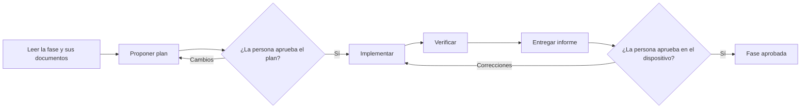
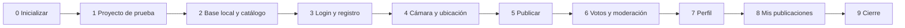

# AvistApp — Fases de desarrollo del MVP

Fuentes: [`1_BRIEF.md`](1_BRIEF.md), [`2_DOMAIN.md`](2_DOMAIN.md), [`3_STACK.md`](3_STACK.md), [`4_DESIGN.md`](4_DESIGN.md). Las referencias como **SG6** o **DESIGN §7.2** apuntan a reglas y secciones de esos documentos.

## 1. Objetivo y alcance

El MVP es la etapa 1 completa: todas las funcionalidades de `1_BRIEF.md` §5, funcionando solo en el dispositivo (sin backend). Está terminado cuando las diez fases de §4 están **aprobadas** y se cumplen los criterios de éxito de `1_BRIEF.md` §10 en un Android y un iPhone físicos.

**Incluye:** registro e inicio de sesión, captura y publicación, muro, votos, mis publicaciones, perfil y colección, moderación del administrador y el catálogo completo de aves de Chile.

**No incluye:** todo lo de `1_BRIEF.md` §7; backend y sincronización (etapa 2); ícono definitivo; compilación y publicación en tiendas.

Este documento **no es una lista de tareas**. Cada fase dice qué se logra, qué leer, qué decisiones ya están tomadas, qué trampas conocidas evitar y cómo se acepta. El plan detallado lo arma quien implementa al empezar la fase, y lo aprueba una persona.

## 2. Cómo se trabaja una fase

Las fases se implementan **de a una y en orden**, con una persona que aprueba el plan antes de empezar y el resultado al terminar.

1. **Preparar.** Leer la fase completa, las secciones de "Lee antes" y el estado actual del repositorio. Marcar la fase "En curso" en §3.
2. **Proponer el plan y esperar aprobación** antes de escribir código. El plan incluye: pasos en orden, archivos que se crean o modifican, la prueba que cubrirá cada criterio **[auto]**, y las dudas o decisiones que los documentos no resuelven. Las decisiones de producto no se inventan: se preguntan (`AGENTS.md`).
3. **Implementar solo el alcance de la fase.** Si hace falta algo de una fase posterior, se implementa lo mínimo y se informa. Si una regla o decisión de los documentos debe cambiar, se detiene el trabajo y se pregunta.
4. **Verificar** con la definición de terminado (abajo).
5. **Entregar un informe:** qué se hizo; archivos tocados; salida de `npx tsc --noEmit`, `npx expo lint` y `npm test`; cada criterio de aceptación con su resultado (los **[auto]** con la prueba que lo cubre; los **[dispositivo]** y **[revisión]** como lista pendiente, con los pasos para verificarlos); desviaciones del plan; documentos actualizados. Marcar la fase "En revisión".
6. **Aprobar.** Una persona verifica los criterios **[dispositivo]** y **[revisión]** y aprueba o pide correcciones. **Solo la persona marca "Aprobada"**, y la fase siguiente no empieza antes.

### Etiquetas de los criterios

| Etiqueta | Quién lo demuestra | Cómo |
|---|---|---|
| **[auto]** | Quien implementa | Una prueba automática que pasa, o un comando sin errores |
| **[dispositivo]** | Una persona | En Expo Go, en dispositivos físicos (`3_STACK.md` §11). Quien implementa nunca lo marca |
| **[revisión]** | Una persona | Leyendo código, configuración o datos; no necesita dispositivo |

### Definición de terminado (todas las fases)

- `npx tsc --noEmit`, `npx expo lint` y `npm test` terminan sin errores.
- Cada criterio **[auto]** está cubierto por una prueba que pasa. Las pruebas verifican comportamiento y bordes, no detalles internos (`AGENTS.md`, Verificación).
- Al recorrer lo nuevo, la terminal de Metro no muestra `Uncaught (in promise)` ni advertencias de `presentation` de Expo Router (`3_STACK.md` §10). `ImageBackground is deprecated` viene de una dependencia y se ignora.
- Se respetan las "Reglas que no se pueden romper" de `AGENTS.md`: textos de interfaz en español de DESIGN §8, sin colores hexadecimales en componentes, valores derivados nunca guardados, sin red.
- Si cambió una regla o decisión, el documento correspondiente se actualizó en el mismo cambio.
- Una persona verificó los criterios **[dispositivo]** y **[revisión]**.

## 3. Mapa de fases y avance

Estados: **Pendiente** → **En curso** → **En revisión** → **Aprobada**. Quien implementa mueve la fase hasta "En revisión"; solo la persona la marca "Aprobada".

| # | Fase | Resultado visible al terminar | Estado |
|---|---|---|---|
| 0 | Inicializar el proyecto | Repositorio con el stack instalado y los comandos de calidad sin errores | Aprobada |
| 1 | Levantar proyecto de prueba | La app abre en Expo Go con el tema, las fuentes y el área segura | Aprobada |
| 2 | Base local, dominio y catálogo | La app crea su base con el catálogo y el administrador; reglas puras probadas | Aprobada |
| 3 | Login y registro | Crear cuenta, iniciar y cerrar sesión; pestañas Muro y Perfil | Aprobada |
| 4 | Cámara y ubicación | Tomar una foto con GPS y verla en Nuevo avistamiento | Aprobada |
| 5 | Publicar avistamiento | Publicar y ver la publicación primera en el Muro | Aprobada |
| 6 | Votos y moderación | Votar, ocultar y moderar desde el Muro | Aprobada |
| 7 | Perfil y colección | Puntaje desglosado y colección en el Perfil | En revisión |
| 8 | Mis publicaciones | Cambiar la especie y eliminar publicaciones propias | Pendiente |
| 9 | Cierre | Recorrido completo aprobado en Android e iPhone | Pendiente |

## 4. Fases

### Fase 0 — Inicializar el proyecto

**Objetivo:** un repositorio con un proyecto Expo (SDK 58), todas las dependencias del stack instaladas y las herramientas de calidad funcionando. Todavía no hay pantallas propias.

**Requiere:** nada. **Lee antes:** STACK §1, §3 y §9; `AGENTS.md` (Comandos, Reglas que no se pueden romper).

**Para armar el plan:**
- Generar con `npx create-expo-app@latest` (plantilla por defecto: TypeScript + Expo Router). Si la carpeta ya tiene `docs/` y el comando no la acepta, generar en una carpeta temporal y mover el contenido a la raíz. Borrar las pantallas y componentes de ejemplo.
- Instalar las dependencias de STACK §1 con `npx expo install` (las de pruebas con `--dev`; `better-sqlite3` y sus tipos con `npm install --save-dev`).
- `tsconfig.json` en modo `strict` con el alias `@/*` → `./src/*`. Carpetas de STACK §3.
- Jest con el preset `jest-expo` y el script `"test": "jest --passWithNoTests"`. ESLint con la configuración de Expo.
- `app.json`: nombre "AvistApp", `userInterfaceStyle: "light"`, *config plugins* (`expo-router`, `expo-splash-screen` con fondo `paper`, `expo-sqlite`, `expo-secure-store`, `expo-font`, `expo-camera` y `expo-location` con los textos de permisos de DESIGN §8) y los experimentos `typedRoutes` y `reactCompiler`.

**Trampas conocidas:**
- Instalar Tailwind con versión explícita (`tailwindcss@^3.4.19`): sin versión se instala Tailwind 4, que no funciona con NativeWind v4.
- Paquetes de Expo o React Native siempre con `npx expo install`, nunca con `npm install`.
- En shells no interactivos, ejecutar los comandos con la entrada estándar cerrada (STACK §9).

**Criterios de aceptación:**
- **[auto]** `npx tsc --noEmit`, `npx expo lint`, `npm test` y `npx expo-doctor` terminan sin errores.
- **[revisión]** `package.json` tiene las dependencias de STACK §1, con NativeWind 4 y Tailwind 3.4; no quedan pantallas de ejemplo de la plantilla.
- **[revisión]** `app.json` tiene el nombre, el tema claro y los textos de permisos de DESIGN §8.

### Fase 1 — Levantar proyecto de prueba

**Objetivo:** la app abre en Expo Go y muestra una pantalla de prueba con el tema, las tipografías y el área segura. Confirma que NativeWind, la paleta y las fuentes funcionan en un dispositivo real antes de construir pantallas.

**Requiere:** Fase 0. **Lee antes:** DESIGN §1–§4 y §10; STACK §8.

**Para armar el plan:**
- NativeWind v4: `global.css`, `babel.config.js`, `metro.config.js`, `nativewind-env.d.ts` e `import "../global.css"` en `app/_layout.tsx`.
- `src/theme/colors.js` con **todos** los tokens de DESIGN §2 (también `white`) y `tailwind.config.js` según DESIGN §10.
- Cargar las fuentes de DESIGN §3 con `useFonts`; `SplashScreen.preventAutoHideAsync()` y ocultar la pantalla de inicio cuando terminan de cargar.
- Una pantalla de prueba temporal (fondo `paper`, título `font-display`, texto `font-sans`) dentro de `SafeAreaView edges={["top"]}` de `react-native-safe-area-context`. Se reemplaza en la Fase 3.

**Trampas conocidas:**
- Una clase por peso de fuente (`font-sans-semibold`); no combinar con `font-bold` (STACK §8).
- Ningún hexadecimal en componentes; `primary-500` nunca es texto.
- Expo Go de las tiendas solo abre la SDK más reciente (STACK §11).

**Criterios de aceptación:**
- **[auto]** Definición de terminado (§2).
- **[dispositivo]** La app abre en Expo Go en un Android y un iPhone físicos: fondo `paper`, título en Fraunces, texto en Figtree, nada bajo la barra de estado o la isla dinámica.
- **[dispositivo]** No se ve texto con la fuente del sistema antes de que carguen las fuentes.

### Fase 2 — Base local, dominio y catálogo

**Objetivo:** al abrir, la app crea su base SQLite con el esquema completo, el catálogo de aves de Chile y el administrador de desarrollo. El dominio puro (tipos, reglas, esquemas, errores y formato de textos) existe y está probado.

**Requiere:** Fase 1. **Lee antes:** DOMAIN completo; STACK §3, §4, §6 y §9; DESIGN §7.2 (fechas y coordenadas) y §8 (mensajes de error).

**Para armar el plan:**
- `src/domain`: `types.ts` (`VoteValue` como `{ UP: 1, DOWN: -1 } as const`), `constants.ts`, `errors.ts` (`DomainError`, códigos de DOMAIN §6, mensajes de DESIGN §8, `errorMessage` que registra los errores inesperados con `console.error`), `schemas.ts` y `rules.ts` (`isHidden`, `userScore`, `progress`).
- `src/components/format.ts`: `formatScore`, `formatCoords`, `formatRelativeDate`, `formatDateTime` (a mano) y `normalizeForSearch`.
- `src/data/db.ts` (interfaz `Db`), migraciones con `PRAGMA user_version` (cada una en una transacción), esquema de STACK §4 en la migración 1, `seed.ts` (catálogo y administrador de §6; para el hash usa `src/auth/password.ts`).
- `assets/species.json`: `{ id, commonName, scientificName }`, con `id` = *slug* del nombre científico. Fuente: [Anexo:Aves de Chile](https://es.wikipedia.org/wiki/Anexo:Aves_de_Chile), con los nombres comunes usados en Chile. Se puede preparar en paralelo con el resto. Revisión `oldid=175351842`, sin especies hipotéticas (H) ni extintas (Ex): 550 especies. Con dos nombres ("A / B") se usa el primero.
- `SQLiteProvider` en el layout raíz: `onInit` con `PRAGMA foreign_keys = ON` y `migrate`.
- `listSpecies(db, actor)` con la marca `inCollection`.
- Pruebas: `src/data/testing/testDb.ts` sobre `better-sqlite3` y los *manual mocks* de `__mocks__/` que hagan falta (`expo-crypto`).

**Trampas conocidas:**
- El orden binario de SQLite deja "Águila" después de "Zorzal": ordenar en TypeScript con `normalizeForSearch`.
- Los valores derivados (`score`, `isHidden`, colección, puntaje) nunca se guardan.
- Columnas en camelCase, fechas ISO 8601 UTC, ids con `randomUUID()` salvo `species.id`.

**Criterios de aceptación:**
- **[auto]** `isHidden`: −4 es visible y −5 está oculto. `userScore` y `progress` con colección vacía y no vacía.
- **[auto]** Esquemas en los bordes: `username` de 2, 3, 20 y 21 caracteres y con caracteres inválidos; contraseña de 7 y 8; latitud y longitud en ±90 / ±180 y fuera de rango; `speciesId` vacío.
- **[auto]** `formatRelativeDate` en cada límite (59 s → "ahora", 1 min, 59 min, 1 h, 23 h, 1 d, 6 d, 7 d → fecha corta); `formatScore` positivo, cero y negativo; `normalizeForSearch("Cóndor")` → `"condor"`.
- **[auto]** `migrate` sobre una base vacía crea las tablas, carga todas las especies y crea el administrador con rol `ADMIN`; ejecutarlo dos veces no duplica datos.
- **[auto]** `species.json` no tiene `id` ni `scientificName` repetidos ni campos vacíos. `listSpecies` ordena "Águila" antes que "Bandurria".
- **[revisión]** Una persona revisa una muestra del catálogo: nombres comunes usados en Chile y nombres científicos correctos.
- **[dispositivo]** La app abre sin errores en una instalación nueva y al reabrirla.

### Fase 3 — Login y registro

**Objetivo:** crear una cuenta, iniciar y cerrar sesión. Sin sesión solo se ven las pantallas de acceso; con sesión, las pestañas Muro (vacío) y Perfil (mínimo, con "Cerrar sesión"). La sesión sobrevive a cerrar la app.

**Requiere:** Fase 2. **Lee antes:** DOMAIN U1–U4 y casos de uso `register`, `login`, `logout`; STACK §5, §6 y §10; DESIGN §6, §7.1, §8 (errores y confirmación de cierre de sesión) y §11 (`Button`, `TextField`).

**Para armar el plan:**
- `src/auth`: `register` (en una transacción), `login`, `saveSession`/`restoreSession`/`logout` con `expo-secure-store`, y `SessionProvider` + `useSession()`.
- Layout raíz: `SQLiteProvider` → `SessionProvider` → `Stack` con `headerShown: false` y dos `Stack.Protected`. La pantalla de inicio se oculta cuando terminó de restaurarse la sesión.
- Pantallas `(auth)/login.tsx` y `(auth)/register.tsx` con React Hook Form, `zodResolver` y modo `onTouched`; confirmar contraseña extendiendo `registerSchema` en la pantalla. `EMAIL_TAKEN` y `USERNAME_TAKEN` bajo su campo.
- `(tabs)/_layout.tsx` con Muro (estado vacío) y Perfil (nombre de usuario y "Cerrar sesión" con confirmación). La pestaña Capturar se agrega en la Fase 4.
- `presentation` explícita en cada `Stack.Screen` con sesión (STACK §10).

**Trampas conocidas:**
- Con `headerShown: false`, las pestañas usan `SafeAreaView edges={["top"]}` (STACK §8).
- En iOS el llavero sobrevive a la desinstalación: `restoreSession` verifica que el usuario exista.
- La tabla `credentials` solo la usa `src/auth`; ningún `User` lleva datos de contraseña.

**Criterios de aceptación:**
- **[auto]** `register` crea el usuario con rol `USER` y sus credenciales. Correo o nombre de usuario repetido, con otras mayúsculas → `EMAIL_TAKEN` / `USERNAME_TAKEN`.
- **[auto]** `login` con contraseña incorrecta → `INVALID_CREDENTIALS`; el correo no distingue mayúsculas.
- **[auto]** Dos usuarios con la misma contraseña tienen hashes distintos y ninguno guarda la contraseña en claro.
- **[auto]** `restoreSession` con un `id` que no existe devuelve `null` y borra la sesión.
- **[dispositivo]** Registrarse lleva al Muro; al cerrar y reabrir la app la sesión sigue activa. Cerrar sesión lleva a Iniciar sesión.
- **[dispositivo]** El administrador entra con las credenciales de §6.
- **[dispositivo]** Los errores aparecen en español bajo cada campo y el teclado no tapa los campos.
- **[dispositivo]** El contenido del Muro y del Perfil no queda bajo la barra de estado ni la isla dinámica.

### Fase 4 — Cámara y ubicación

**Objetivo:** la pestaña Capturar abre la cámara a pantalla completa; al disparar se obtienen la foto y la ubicación, y se abre Nuevo avistamiento con la foto, las coordenadas y la hora. Todavía no se publica.

**Requiere:** Fase 3. **Lee antes:** DOMAIN SG1 y SG2; STACK §7, §10 y §11; DESIGN §6, §7.3, §7.4 y §8 (permisos, cámara y fallas del sistema).

**Para armar el plan:**
- Pestaña Capturar sin contenido (`(tabs)/new.tsx` devuelve `null`): su `tabPress` llama a `preventDefault` y `router.push("/capture")`.
- `capture.tsx`: estados de permisos (`useCameraPermissions`, `Location.useForegroundPermissions`, "Abrir ajustes" si `canAskAgain` es `false`); `CameraView` con `onCameraReady` y `onMountError`; disparador deshabilitado hasta que la cámara está lista.
- Al disparar: `capturedAt` antes de cualquier `await`; `Promise.allSettled` con `takePictureAsync({ quality: 0.7, base64: true })` y `getCurrentPositionAsync` de alta precisión; un mensaje por cada falla; navegar a `/publish` con `photoBase64`, latitud y longitud como texto y `capturedAt`.
- `publish.tsx`: encabezado con `pt-14`, vista previa `data:image/jpeg;base64,…` con `style={{ aspectRatio: 4 / 3 }}`, coordenadas y fecha formateadas, "Repetir foto" con `router.back()`. "Publicar" queda deshabilitado hasta la Fase 5.
- `capture` y `publish` con `presentation: "fullScreenModal"`.

**Trampas conocidas:**
- Nunca pasar un URI `file://` entre pantallas ni reconstruir un `File` desde él (STACK §7).
- No usar un único `catch` para cámara y GPS: una falla de cámara se mostraría como error de ubicación.
- Una pantalla `card` encima de un modal queda invisible (STACK §10).
- El emulador de Android entrega una foto negra sintética y una ubicación fija; el simulador de iOS no tiene cámara (STACK §11).

**Criterios de aceptación:**
- **[auto]** Definición de terminado (§2). Esta fase no agrega reglas de dominio.
- **[dispositivo]** Rechazar un permiso muestra el mensaje de DESIGN §8; rechazarlo de forma permanente muestra "Abrir ajustes".
- **[dispositivo]** Al abrir la cámara, el disparador está deshabilitado (con indicador) hasta que la vista previa está lista.
- **[dispositivo]** Con el GPS apagado aparece el mensaje de `INVALID_LOCATION` y el usuario sigue en la cámara.
- **[dispositivo]** Nuevo avistamiento muestra la foto recién tomada, las coordenadas y la hora, bajo la barra de estado. "Repetir foto" vuelve a la cámara; cerrar la cámara vuelve a la pestaña anterior.
- **[dispositivo]** Funciona en un iPhone físico y en Android (físico, o emulador con la foto sintética).

### Fase 5 — Publicar avistamiento

**Objetivo:** elegir la especie, publicar y ver la publicación primera en el Muro. La foto queda guardada en el dispositivo y sobrevive a cerrar la app.

**Requiere:** Fase 4. **Lee antes:** DOMAIN SG1, SG1a, SG2, SG7, C1, Q1 y los casos de uso `listSpecies`, `createSighting` y `getFeed`; STACK §4, §7 y §10; DESIGN §5, §7.2, §7.4, §7.5 y §8.

**Para armar el plan:**
- `SpeciesPicker` (DESIGN §7.5): búsqueda sin tildes ni mayúsculas y marca "En tu colección".
- `createSighting` según STACK §7: valida, asegura `photos/`, inserta la fila y después escribe la foto con `writeAsStringAsync` de `expo-file-system/legacy`; si la escritura falla, borra la fila y relanza (SG1a). `resolvePhotoUrl` para leer. *Manual mock* `__mocks__/expo-file-system/legacy.ts`.
- `publish.tsx`: "Publicar" deshabilitado hasta elegir especie y con indicador mientras guarda; error sobre el botón; al terminar, `router.dismissTo({ pathname: "/(tabs)", params })`.
- `getFeed` (Q1) y el Muro con `SightingCard` (foto 4:3, autor, fecha relativa, nombres, coordenadas; propia: puntaje y "Tu publicación"); recarga con `useFocusEffect` y al deslizar; estado vacío con "Tomar una foto".
- Aviso de especie nueva (`NewSpeciesBanner`) con el valor de `SPECIES_BONUS`.
- Datos de prueba en desarrollo (`seedDevData`, `__DEV__`): usuarios, avistamientos con fotos de prueba y votos que se regeneran en cada inicio (§6).

**Trampas conocidas:**
- No usar la API de clases de `expo-file-system` (`File`, `Directory`, `Paths`): rechaza con `Missing 'READ' permission` en Android.
- Toda promesa nativa va con `await` dentro del `try`.
- `router.replace` deja la cámara abierta después de publicar; usar `router.dismissTo`.
- `aspect-[4/3]` deja la imagen con alto 0; usar `style={{ aspectRatio: 4 / 3 }}`.

**Criterios de aceptación:**
- **[auto]** `createSighting` rechaza coordenadas fuera de rango (`INVALID_LOCATION`) y especies inexistentes (`SPECIES_NOT_FOUND`).
- **[auto]** `isNewSpecies` es `true` la primera vez y `false` la segunda con la misma especie.
- **[auto]** Si escribir la foto falla, `createSighting` rechaza, no queda ningún avistamiento y un reintento funciona (SG1a; se simula con `jest.spyOn` sobre el mock de `writeAsStringAsync`).
- **[auto]** El muro se ordena por `createdAt` descendente.
- **[dispositivo]** "Publicar" está deshabilitado hasta elegir una especie; buscar "condor" encuentra "Cóndor".
- **[dispositivo]** Al publicar, la app vuelve al Muro (no a la cámara) y la publicación aparece primera; si la especie es nueva, aparece el aviso con +10.
- **[dispositivo]** La foto sigue visible después de cerrar y reabrir la app.

### Fase 6 — Votos y moderación

**Objetivo:** votar publicaciones ajenas desde el Muro, cambiar y retirar el voto. Las publicaciones que llegan a −5 salen del muro; el administrador las ve marcadas y puede eliminar cualquier publicación.

**Requiere:** Fase 5. **Lee antes:** DOMAIN SG4–SG6, V1–V6, Q1–Q3 y C1, y los casos de uso `castVote`, `removeVote` y `deleteSighting`; STACK §4; DESIGN §5, §7.2, §8 (confirmaciones) y §9.

**Para armar el plan:**
- `castVote` y `removeVote` dentro de `withExclusiveTransactionAsync`: existe, no es propio, no está oculto.
- `getFeed` completo: puntaje y voto del usuario actual calculados en SQL, `isHidden` derivado, ocultos solo para `ADMIN`.
- `VoteControl`: tocar el voto activo lo retira; tocar el otro lo cambia; `accessibilityState={{ selected }}`.
- Vista de `ADMIN` en `SightingCard`: foto al 50 %, insignia "Oculta", sin votos; papelera con confirmación que usa `deleteSighting` (SG4: borra la fila y luego el archivo).
- Animaciones de voto y de salida de tarjeta, desactivadas con `useReducedMotion`.

**Trampas conocidas:**
- Ocultar es definitivo (V5): en un avistamiento oculto no se vota, ni se cambia ni se retira un voto.
- Reanimated 4.7.1 expone `get()`/`set()` en `SharedValue`, pensados para el React Compiler: se usan en vez de `sharedValue.value = …`, sin desactivar ningún lint.
- Ocultar requiere seis cuentas: los datos de desarrollo traen sofia_campo y una publicación en −4 (§6); las reglas las cubren las pruebas automáticas.

**Criterios de aceptación:**
- **[auto]** Votar dos veces cambia el valor, no duplica el voto (V1). Votar el propio avistamiento → `OWN_SIGHTING` (V3).
- **[auto]** Con cinco votos `DOWN` el avistamiento queda oculto; un sexto voto → `SIGHTING_HIDDEN` (SG6, V5).
- **[auto]** `removeVote` en un avistamiento oculto → `SIGHTING_HIDDEN`; sin voto previo → `VOTE_NOT_FOUND`.
- **[auto]** Un avistamiento oculto no aparece para `USER` y sí aparece, marcado, para `ADMIN`. Cada elemento del muro trae el voto del usuario actual.
- **[auto]** `deleteSighting`: un usuario que no es autor ni `ADMIN` → `FORBIDDEN`; el autor y el `ADMIN` pueden eliminar; los votos se borran con el avistamiento.
- **[auto]** Si el único avistamiento de una especie quedó oculto, un nuevo avistamiento de esa especie vuelve a ser `isNewSpecies` (C1).
- **[dispositivo]** Votar, cambiar y retirar el voto actualiza el puntaje de inmediato. La publicación propia muestra "Tu publicación" en vez de los votos.
- **[dispositivo]** Un voto que oculta una publicación la saca del muro.
- **[dispositivo]** El administrador ve las ocultas atenuadas con la insignia "Oculta" y puede eliminarlas tras confirmar.

### Fase 7 — Perfil y colección

**Objetivo:** el Perfil muestra el puntaje desglosado, el progreso de la colección ("X de N especies") y la foto de cada especie coleccionada.

**Requiere:** Fase 6. **Lee antes:** DOMAIN C1–C4 y el caso de uso `getProfile`; STACK §4; DESIGN §5 y §7.6.

**Para armar el plan:**
- `getProfile(db, actor)`: suma de votos de todos los avistamientos (también ocultos), colección con las especies de avistamientos visibles, foto visible más reciente de cada especie, orden alfabético sin distinguir tildes, tamaño del catálogo y progreso.
- Pantalla (DESIGN §7.6): avatar, nombre, insignia `ADMIN`, "Salir" con confirmación, puntaje con su desglose, `ProgressBar` animada, botón "Mis publicaciones" (la pantalla llega en la Fase 8) y grilla de la colección.

**Trampas conocidas:**
- Todo se calcula al leer (C4): publicar y eliminar no deja puntos guardados.
- Las fotos cuadradas usan `aspect-square`, que sí funciona en NativeWind.

**Criterios de aceptación:**
- **[auto]** `userScore` = suma de votos de todos los avistamientos (ocultos incluidos) + 10 × especies de la colección (ocultos excluidos).
- **[auto]** Eliminar el único avistamiento de una especie quita su bonus; publicar y eliminar deja el puntaje igual que antes (C4).
- **[auto]** La foto de cada especie en la colección es la del avistamiento visible más reciente.
- **[dispositivo]** El puntaje y la colección del perfil coinciden con lo que se ve en el muro; la barra de progreso se anima (salvo con reducción de movimiento).
- **[dispositivo]** Con la colección vacía se muestra el texto de DESIGN §7.6.

### Fase 8 — Mis publicaciones

**Objetivo:** desde el Perfil se abre Mis publicaciones, con todas las publicaciones propias (también las ocultas), donde se puede cambiar la especie o eliminar.

**Requiere:** Fase 7. **Lee antes:** DOMAIN SG3, SG4 y Q4, y los casos de uso `getMySightings`, `changeSpecies` y `deleteSighting`; STACK §10; DESIGN §7.7 y §8.

**Para armar el plan:**
- `getMySightings(db, actor)` (Q4) y `changeSpecies(db, actor, sightingId, speciesId)` (SG3: solo el autor; los votos se mantienen).
- `my-sightings.tsx` con `presentation: "card"` y encabezado `pt-14`: miniaturas, insignia "Oculta" con su explicación, "Cambiar especie" con `SpeciesPicker`, "Eliminar" con confirmación, estado vacío con "Tomar una foto".

**Trampas conocidas:**
- Abrir la cámara desde esta pantalla y publicar debe volver al Muro (`router.dismissTo`).

**Criterios de aceptación:**
- **[auto]** `getMySightings` incluye los ocultos, marcados.
- **[auto]** `changeSpecies` mantiene los votos; si no es el autor → `NOT_OWNER`.
- **[dispositivo]** Cambiar la especie actualiza la colección del perfil; eliminar quita la publicación de la lista y del muro.
- **[dispositivo]** Con la lista vacía se muestra el texto de DESIGN §7.7, y "Tomar una foto" abre la cámara.

### Fase 9 — Cierre

**Objetivo:** la app cumple la accesibilidad y los estados de todas las pantallas, y una persona aprueba el recorrido completo en Android y en iPhone.

**Requiere:** Fase 8. **Lee antes:** `1_BRIEF.md` §10; DESIGN §7 (estados) y §9; STACK §11.

**Para armar el plan:**
- Revisión de accesibilidad (DESIGN §9): etiquetas y roles, estados de los votos, áreas táctiles de 44 px, tamaño de letra máximo del sistema y reducción de movimiento.
- Estados de carga, error ("Reintentar") y vacío en todas las pantallas que cargan datos (DESIGN §7).
- `npx expo-doctor` sin problemas.
- Preparar para la persona un guion del recorrido completo y la lista de criterios **[dispositivo]** de fases anteriores que sigan pendientes.

**Criterios de aceptación:**
- **[auto]** Definición de terminado (§2) y `npx expo-doctor` sin problemas.
- **[revisión]** La lista de verificación de accesibilidad de DESIGN §9 está revisada pantalla por pantalla.
- **[dispositivo]** Recorrido completo en un Android y un iPhone físicos: registro, publicación, votos con dos cuentas, perfil, mis publicaciones y moderación.
- **[dispositivo]** Con el tamaño de letra máximo del sistema, las pantallas siguen usables.
- **[dispositivo]** Se cumplen los criterios de éxito de `1_BRIEF.md` §10.

## 5. Riesgos

| Riesgo | Mitigación |
|---|---|
| Expo Go de las tiendas solo abre proyectos de la SDK más reciente | Mantener el proyecto en la SDK de Expo Go; si no es posible, usar un *development build* |
| Una SDK nueva cambia el comportamiento de cámara, archivos o navegación | La SDK de referencia es la 58 (STACK §1); al cambiarla, repetir los criterios **[dispositivo]** de las fases 4 y 5 |
| El simulador de iOS no tiene cámara y el emulador de Android entrega una foto sintética con ubicación fija | Aceptación de las fases 4 y 5 en dispositivos físicos (STACK §11) |
| La API de clases de `expo-file-system` rechaza operaciones con `Missing 'READ' permission` en Android | Usar `expo-file-system/legacy` y pasar la foto como base64 (STACK §7) |
| Una pantalla queda oculta detrás de un modal, o publicar vuelve a la cámara | `presentation` explícita en cada pantalla y `router.dismissTo` al salir del flujo modal (STACK §10) |
| Un error nativo se ve solo como "Algo salió mal" y no se puede diagnosticar | `errorMessage` y la cámara registran el error original con `console.error` (STACK §6) |
| Una fase crece y mezcla trabajo de otras | Plan aprobado antes de implementar y alcance limitado a la fase (§2) |
| Probar el ocultamiento en el dispositivo requiere seis cuentas | Pruebas automáticas (Fase 6) y datos de desarrollo con seis cuentas y una publicación en −4 (§6) |
| El catálogo tiene errores o nombres que no se usan en Chile | Pruebas de integridad de `species.json` y revisión de una persona (Fase 2) |
| En iOS la sesión sobrevive a la desinstalación | `restoreSession` verifica que el usuario exista (Fase 3) |
| Las fotos llenan el almacenamiento | Calidad 0.7 al capturar; la foto se borra al eliminar la publicación |
| Las credenciales de desarrollo llegan a una versión publicada | Publicar está fuera del MVP; antes de hacerlo, quitarlas del seed |

## 6. Datos de desarrollo

Administrador creado por el seed (solo para desarrollo):

| Campo | Valor |
|---|---|
| Correo | `admin@avistapp.local` |
| Usuario | `admin` |
| Contraseña | `avistapp-admin` |

### Datos de prueba (solo en desarrollo)

Cada vez que la app inicia en desarrollo (`__DEV__`), `seedDevData` (`src/data/devSeed.ts`, Fase 5) borra los avistamientos, los votos y los usuarios de prueba —todo salvo el administrador y el catálogo— y los recrea, "como si la app se reiniciara". Sirve para probar el Muro sin depender de la cámara real. A diferencia del administrador, el guardado está detrás de `__DEV__`: no corre nunca en una versión publicada y no hace falta quitarlo a mano.

| Usuario | Correo | Contraseña |
|---|---|---|
| ana_aves | `ana@avistapp.test` | `avistapp-test` |
| pedro_birder | `pedro@avistapp.test` | `avistapp-test` |
| camila_fotos | `camila@avistapp.test` | `avistapp-test` |
| javier_sur | `javier@avistapp.test` | `avistapp-test` |
| sofia_campo | `sofia@avistapp.test` | `avistapp-test` |

Ocho avistamientos repartidos entre estos usuarios y el administrador, con fotos de prueba (bloques de color generados sin red) y votos variados; dos son del administrador, con puntaje +4 y −1, visibles de inmediato en el Muro. Uno de ana_aves (Picaflor chico) queda en −4: con sofia_campo, un voto negativo lo oculta y sale del Muro; después el administrador lo ve como "Oculta".
